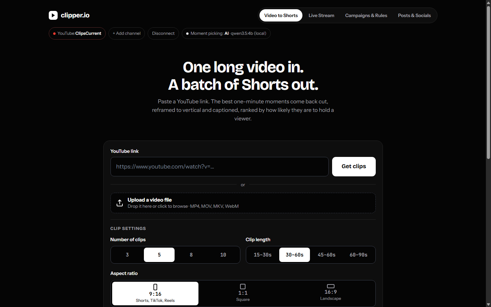
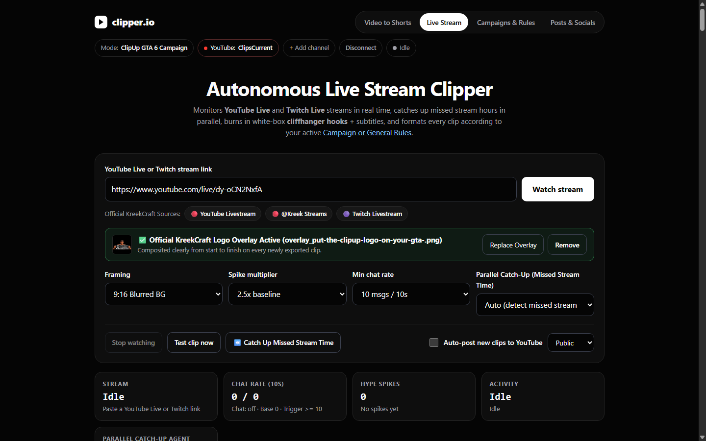
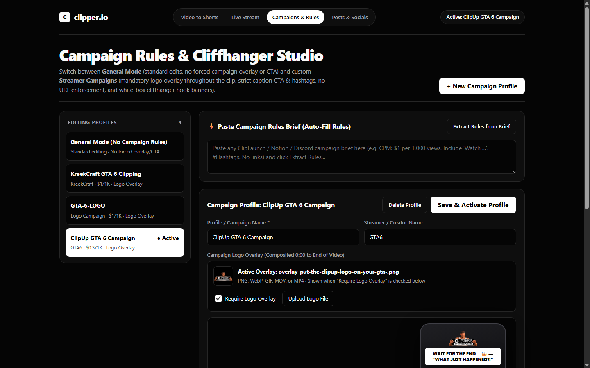
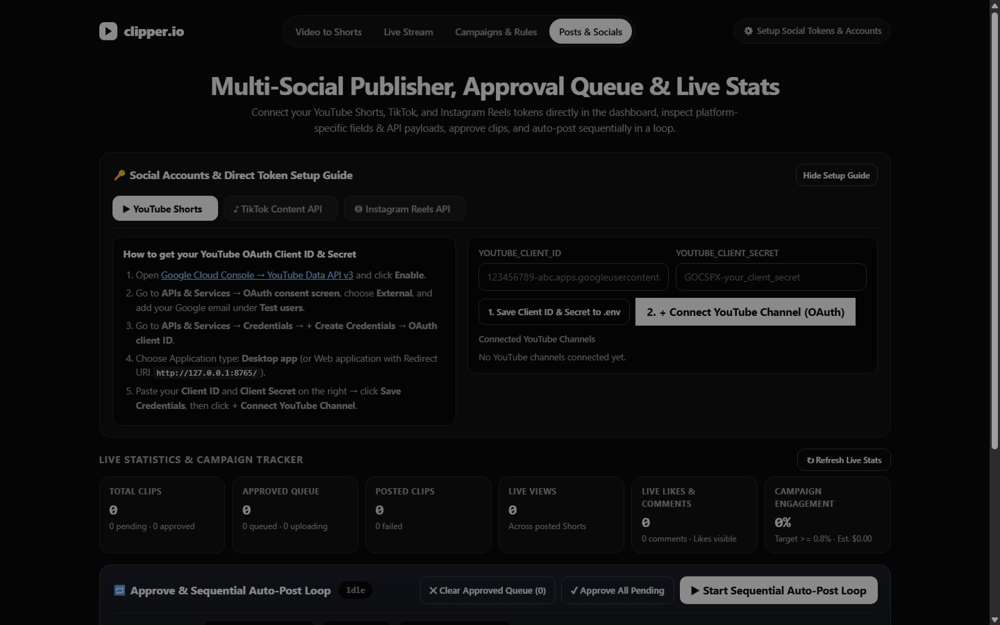

<p align="center">
  
</p>

<h1 align="center">Clipper</h1>

<p align="center">
  <strong>Open-source AI video clipper, live stream watcher, and multi-social auto-publisher.</strong><br/>
  Turn long YouTube videos, local recordings, or live YouTube &amp; Twitch streams into vertical 9:16 viral Shorts, TikToks, and Reels — with campaign compliance and anti-block jittered posting.
</p>

<p align="center">
  <a href="LICENSE"></a>
  
  
  
  <a href="SKILL.md"></a>
</p>

---

## Why Clipper?

| Feature | Clipper | OpusClip Free | OpusClip Paid |
| :--- | :--- | :--- | :--- |
| **Price** | **Free & Open Source (MIT)** | \$0 | From \$15/month |
| **Monthly Clip Limit** | **Unlimited** | 60 credits | 150+ credits |
| **Watermark** | **None** | Yes | No |
| **Live Stream Catch-Up Watcher** | **YouTube Live + Twitch** | No | Limited |
| **Campaign Rules & Compliance Studio** | **Built-in** | No | No |
| **Multi-Social Auto-Posting** | **YouTube + TikTok + IG Reels** | Limited | Yes |
| **Anti-Block Jitter & Cooldowns** | **Built-in (`±30%` / `±50%`)** | No | No |
| **Runs Locally on Your Machine** | **Yes** | No | No |

---

## Interface & Screenshots

### 1. Video Clipper Studio (`/`)
Paste any YouTube URL or upload a local video. Clipper transcribes audio (Whisper fallback when captions are absent), picks high-retention moments, reframes to `9:16` / `1:1` / `16:9` with face tracking, burns active-word pop captions, and exports MP4s or a one-click ZIP.



### 2. Live Stream Watcher & Parallel Catch-Up (`/watcher`)
Monitor live YouTube and Twitch streams for chat hype spikes, backfill missed stream hours concurrently, burn campaign logo overlays, and export all live clips as a ZIP (`GET /api/watcher/zip`).



### 3. Campaigns & Rules Studio (`/campaigns`)
Define campaign rules (required CTAs, required hashtags, link stripping, logo overlays, and payout/engagement targets) or parse a campaign brief automatically. Every clip is checked for rule compliance before posting.



### 4. Multi-Social Queue & Sequential Auto-Post Loop (`/posts`)
Approve clips, inspect live views/likes/comments, and run the sequential auto-post loop across **YouTube Shorts**, **TikTok**, and **Instagram Reels** with anti-block jitter, per-platform cooldowns, and quota auto-wait.



---

## Key Capabilities & Improvements

- **Pro Vertical Rendering (`app/render.py`, `clip-watcher/captioner.py`)**:
  - Face-tracking `9:16` split/fill/fit reframing via OpenCV + `ffmpeg`.
  - Active-word pop ASS captions (`\fscx114\fscy114\t(0,80,\fscx100\fscy100)`) and clean, emoji-free white hook banners (`<= 42` chars, whole-reel curiosity hooks).
  - Broadcast `-14 LUFS` loudness normalization (`loudnorm=I=-14:TP=-1.5:LRA=11`) and smooth audio fade-in.
- **Closed-Loop AI & Famous-Clipper Metadata (`app/selector.py`, `app/watcher.py`)**:
  - Feeds top/bottom performing posted clips (`live_stats` views & engagement) back into AI prompts (`_build_learning_context()`).
  - Generates 3rd-person reaction titles, human engagement captions, and a 5-tag discovery/campaign hashtag mix — even offline without an LLM (`AI_PROVIDER=none` or when local models are out of memory).
- **Resilient Multi-Social Publishing (`app/socials.py`, `app/main.py`)**:
  - **YouTube Shorts**: OAuth + multi-channel rotation + live stats tracker + opt-in **Auto-wait on quota reset**.
  - **TikTok**: Built-in PKCE (`S256`) OAuth, 24h auto-refresh, 24h `force_inbox_draft` (`MEDIA_UPLOAD`) caching (1 `init` call instead of 3), 15s+ jittered `init` pacing, and graceful pause on TikTok's ~5-draft Inbox limit (`spam_risk_too_many_pending_share`).
  - **Instagram Reels**: Graph API v21.0 resumable upload.
  - **Sequential Loop**: Configurable `delay_seconds`, `±30%` / `±50%` anti-block jitter, `65–95s` per-platform rate-limit cooldowns, `best_first` ranking, and `max_posts` targeting.

---

## Quick Start

### 1. Prerequisites
| Requirement | Windows | macOS | Linux |
| :--- | :--- | :--- | :--- |
| **Python 3.10+** | [python.org](https://www.python.org/downloads/) | `brew install python` | Package manager |
| **ffmpeg** | `winget install Gyan.FFmpeg` | `brew install ffmpeg` | `sudo apt install ffmpeg` |
| **Deno** *(or Node.js)* | `winget install DenoLand.Deno` | `brew install deno` | `curl -fsSL https://deno.land/install.sh \| sh` |
| **Ollama** *(optional local AI)* | [ollama.com](https://ollama.com/download) | [ollama.com](https://ollama.com/download) | `curl -fsSL https://ollama.com/install.sh \| sh` |

### 2. Install & Run
```bash
git clone https://github.com/Umair-Zahid2510/clipper.git
cd clipper
```
- **Windows**: Run `setup.bat`, then `run.bat`
- **macOS / Linux**: Run `./setup.sh`, then `./run.sh`

Open **http://127.0.0.1:8765** in your browser.

---

## Use as an AI Agent Skill

Clipper ships with a standard [`SKILL.md`](SKILL.md) (and [`.agents/skills/clipper-io/SKILL.md`](.agents/skills/clipper-io/SKILL.md)) compatible with **Antigravity, Claude Code, Cursor, Codex, Windsurf, Gemini CLI, and Agensi**.

---

## Configuration (`.env`)

Copy `.env.example` to `.env`:

| Variable | Purpose |
| :--- | :--- |
| `AI_PROVIDER` | `ollama` (local), `gemini`, `claude`, or `none` (fast deterministic clipper captions) |
| `GEMINI_API_KEY` / `ANTHROPIC_API_KEY` | Cloud LLM key if not using local Ollama |
| `YOUTUBE_CLIENT_ID` / `YOUTUBE_CLIENT_SECRET` | YouTube Data API v3 OAuth ([docs/youtube-setup.md](docs/youtube-setup.md)) |
| `TIKTOK_CLIENT_KEY` / `TIKTOK_CLIENT_SECRET` | TikTok Content Posting API v2 PKCE OAuth |

## Known Platform Limits
- **YouTube Data API v3**: `videos.insert` has a 100 calls/day quota bucket (resetting midnight PT). Enable **Auto-wait on quota reset** in `/posts` for multi-day queues.
- **TikTok Unaudited / Sandbox Apps**: Public accounts fall back to Inbox Drafts (`MEDIA_UPLOAD`), capped at ~5 unpublished drafts until cleared in the TikTok mobile app (**Inbox -> System Notifications**).

## License
MIT — see [LICENSE](LICENSE).
